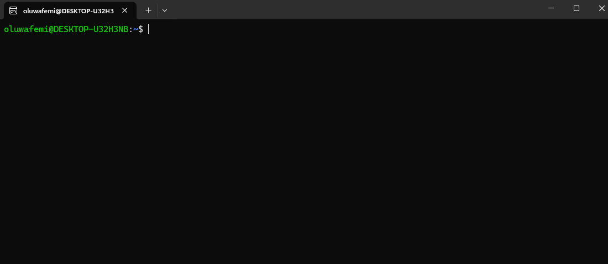
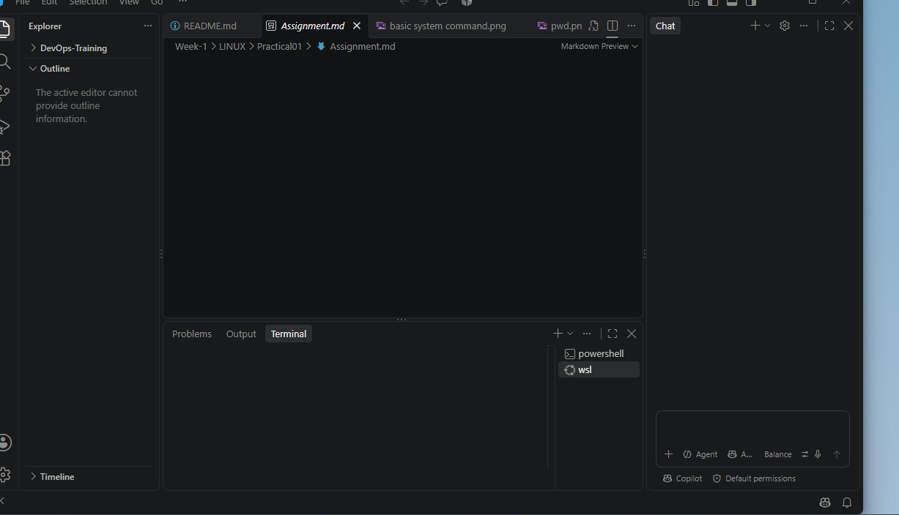
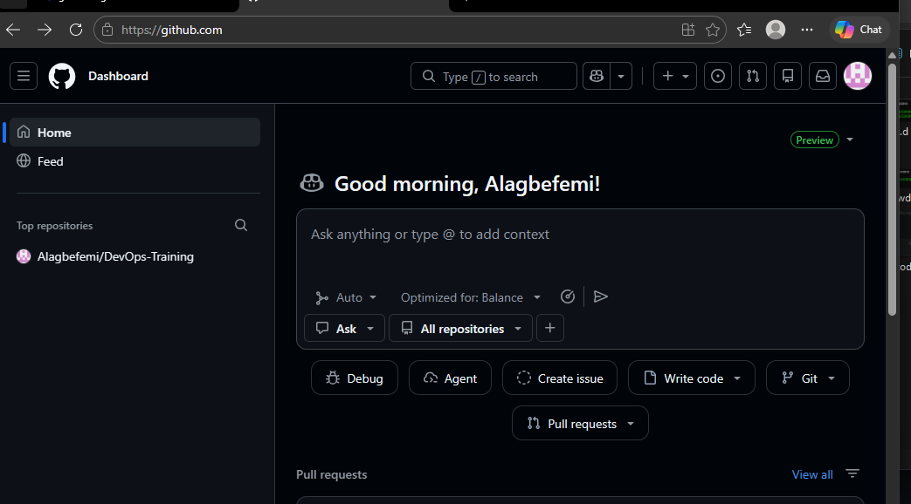
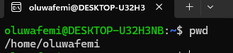
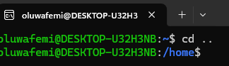
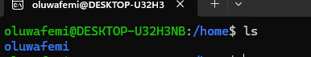
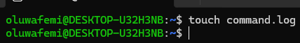

#   TASK TO DO FOR LESSON ONE WEEK 1
###### - Set up ubuntu/WSL or a VM, VS code, Github And Hashnode
###### - Run Basic Identification Commands
#### Evidence: Screenshot the terminal setup and explain five command
 --- > NOTE:All The Screenshot Are Inside **EVIDENCE** 
 
 ## ANSWER

 `Ubuntu terminal`
 

 `VS CODE`
 

 `Github`
 


 `Hashnode`
 

`BASIC IDENTIFICATION COMMANDS`


### explain 5 commands
1. `PWD`: This command is used to know the current working directory. It is also know as `where am i`
```bash
PWD
```


2. `CD ..`: This command is used to go back to any working directory or go back to previous directory. In simple language it means `GO BACK`
```BASH
CD ..
```


3. `LS`: This command is know as `LIST`. It is used to list files and other directory inside a directory
```bash
LS
```


4. `TOUCH`:This command is used to create an empty file. for example, if i run ***touch command.log*** it means create me an empty file and name it command.log
```bash
TOUCH
```


5. `ECHO`: This command means write or print. For example **echo** " i love linux". This means write or print i love linux. `   REDIRECTION >` This command or sign is used to put a note or text inside an empty file or exixting files if the user do not want the result of the first command (echo for instance) to be display on the terminal. However, one redirection sign > is used to overwrite the content in the file but to add to the existing content two redirectio sign is used >>

**NOTE**: The screenshot below contain two linux command `echo` and `redirection` **>**
```BASH
ECHO 
REDIRECTION 
```

