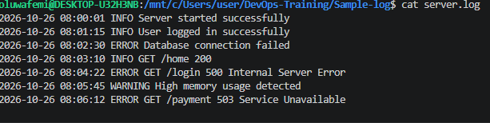
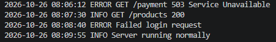
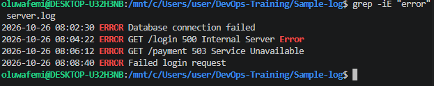
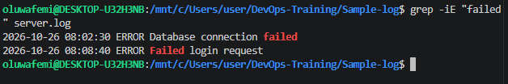
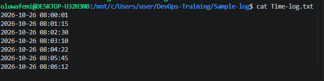
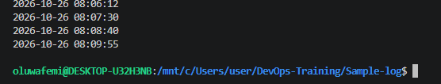
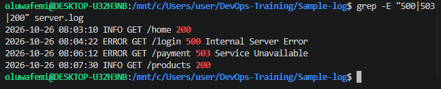
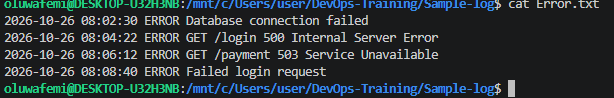
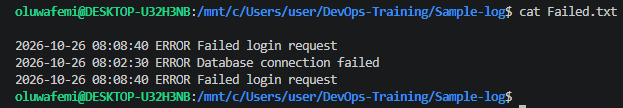
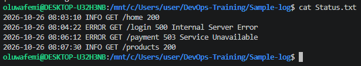

# Create  a Sample Log File And Extract Errors, Timestamps and Failed requests
## Evidence:Save The Filtered Output And Explain The Commands Used.

# SOLUTION
#### 1a `Sample Log File` Created


#### 1b `Extracted Error`

#### 1c `Extracted failure`

#### 1d `Extracted timestamps`


#### 1e `Extracted status`


## 2 `Saved output`
#### 2a `ERROR OUTPUT`
#### `Command Used`:
```bash
 grep -iE "error" server.log >
 ```
 #### Explanation:`grep` means filter. So i told wsl to filter the word `error` from an existing file called server.log, and i used `>` which is known as redirection to put the result from grep into a new file called Error.txt, While -iE is used to look for the word either in uppercase or lowercase but if only `-E` is used, it only search multiple condition in a file.



#### 2b `FAILED OUTPUT`
#### `Command Used`:
```bash
grep -iE "Failed" server.log >
```
#### Explanation:`grep` means filter. So i told wsl to filter the word `Failed` from an existing file called server.log, and i used `>` which is known as redirection to put the result from grep into a new file called Failed.txt, While -iE is used to look for the word either in uppercase or lowercase but if only `E` is used, it only search multiple condition in a file.


#### 2c `Timestamp Output`
#### `Command Used`:
```bash
awk '{print $1, $2} server.log >
```
#### Explanation: `awk` means select a field given in a file. For example in this command, i told wsl to select the first and the second field in an existing file called server.log, write the infomation out and used redirection `>` to put it in a new file called Time-log.txt. NOTE:`print` mean write, `$1 $2` mean first and second field.


#### 2d `Status Output`
#### `command used`:
```bash
grep -E "500|503|200" server.log > status.txt
```
#### Explanation: `grep` mean filter , `-E` is used to look for multiple condition. So i told wsl to filter this multiple condition `500/503/200` inside an existing file called server.log and put it in a new file called Status.txt using redirection `>`.


## `HAPPY REVIEW MA`