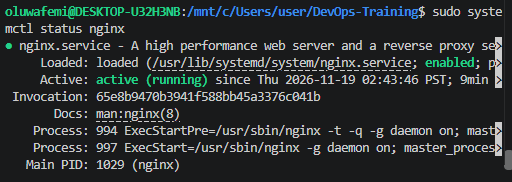
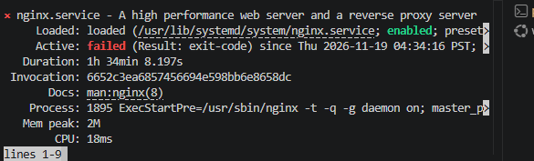
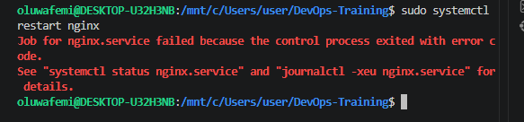
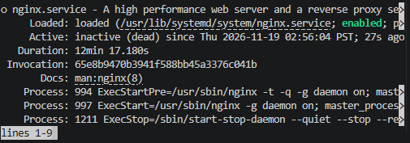

# TASK TO DO
Install `Nginx`;Start,Stop,Restart And Diagnose It Using Systemctl And Journalctl
### EVIDENCE
Show `Nginx` Running And Document One Service Failure

# SOLUTION
#### Running `Nginx`

#### Nginx Failure

#### Stop Nginx
