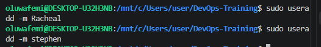
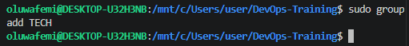
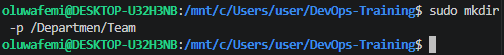
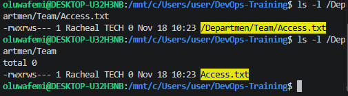
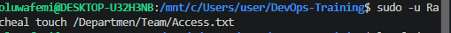
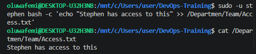
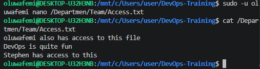
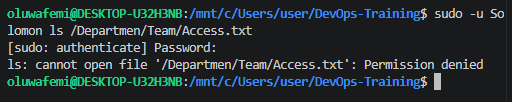

# QUESTION
#### Understand Ownership, Sudo, Read/Write/execute Permission And Numeric Permission values.
## TASK
Create users and a shared group directory,configure and text access permission
## EVIDENCE
Show permission output, and test from different users
# SOLUTION
#### User Created

#### Group Created

#### Shared Group Directory

#### Configured permission

## Permission Test From Users
#### List Of Users In The Group
Racheal
Oluwafemi
Stephen
#### List Of User Outside The Group
Solomon
#### Test from Racheal

#### Test from Stephen

#### Test from Oluwafemi

#### Test from Solomon

# HAPPY REVIEW MA