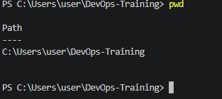
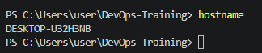
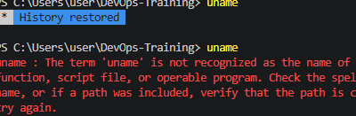
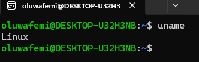
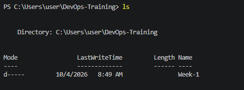
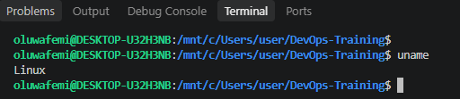
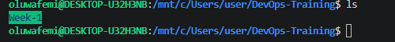
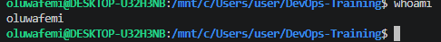
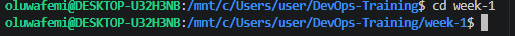

# LINUX PRACTICAL FOR WEEK ONE
# TASK TO DO: RUN  BASIC SYSTEM IDENTIFICATION COMMAND
## I Checked My Current Working Directory
The command i used was
```bash
pwd 
```


## I used Command HOSTNAME to know the device i am operating on
```bash
hostname
```


### I encountered some error while trying to run some command on the terminal inside VSCODE and the screenshot are shown below

`error`



### But when i ran the command on ubuntu, it works very fine

Proof of `UNAME` command on ubuntu


### I ran `LS` command see all the directory i have but i got different answer from the terminal on VScode and ubuntu terminal  



### Everything is now working perfecly since i connected my `WSL` to my vscode

### To know the operating system i was working on i ran `UNAME`
```bash
UNAME
```


### I ran `LS` code to know all my folders also known as directory
```bash
LS
```


### I ran `WHOAMI` to know the name of the current user
```bash
WHOAMI
```


### I ran `CD` command which means i went back to my root directory which is week-1
```bash
CD
```

