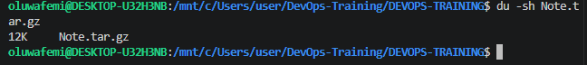

# TASK
 Use df, du, free, lsblk, tar and gzip to inspect and archive files.
 ## EVIDENCE
 Submit before-and-after archive sizes and findings.

 # SOLUTION
 The Files To Be Archive Are Shown Below In a Photo Evidence: `NOTE` All the three files are inside a directory called `Note-files`
 

#### Disk usage of `Note-files` before archieve and compressing

#### Disk usage after archive and compressing

### MY FINDINGS
I find out that after the files has been archived, the original file still exist, the size of the original files is untouch. The new arcieved file now ends with `.tar` with the chosen name. I also discovered that even after archieve the new archieved files size remain as of the original until it is compressed. I also noticed that after the file being compressed, the compressed files names now ends with .gz i.e `.tar.gz` which explain that the files is compressed. foe example, if the name of the file after archieve is called `learn.tar`, the name will changed to `learn.tar.gz` after been compressed.
### COMMAND USED IN THIS PART OF THE LESSON ARE LISTED BELOW
``` bash
df -h
du -sh
free -h
tar -cvf
gzip
```
# HAPPY REVIEW MA
