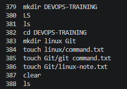

## TASK
### Create a Structured DevOps-Training directory; Create, copy, move, find and delete files
### EVIDENCE; Submit The Directory Tree And History

# SOLUTION
#### 1 Directory Tree

#### 2 History

